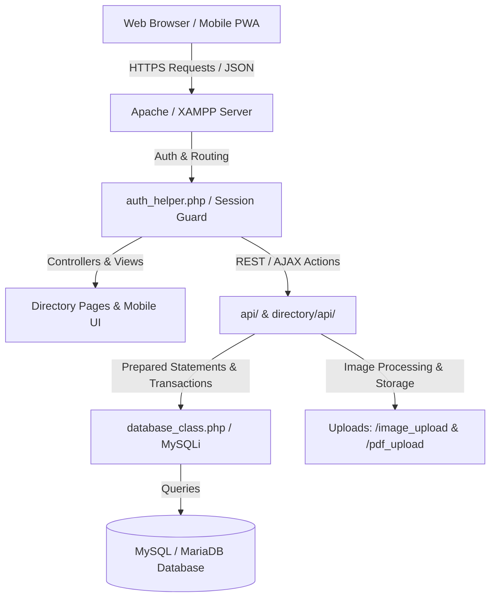
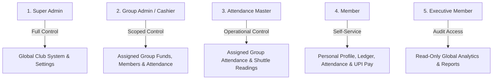
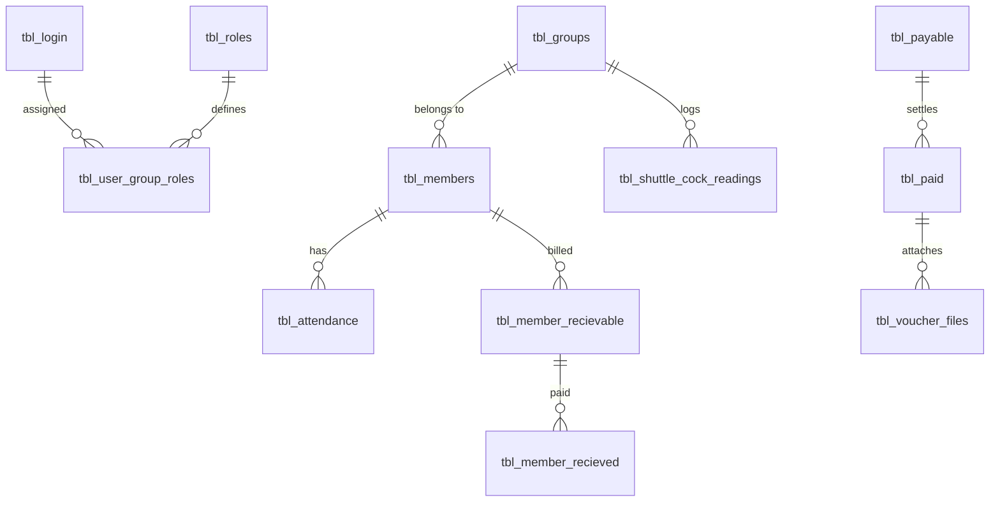

# 🏸 YMCA ClubPulse — Club Accounts, Member Attendance & Sports Operations ERP
## Comprehensive Project Documentation & Technical Specification

---

## 📋 Table of Contents
1. [Executive Summary & System Purpose](#1-executive-summary--system-purpose)
2. [Key Highlights & Core Differentiators](#2-key-highlights--core-differentiators)
3. [Technology Stack & System Architecture](#3-technology-stack--system-architecture)
4. [Role-Based Access Control (RBAC) & Permissions](#4-role-based-access-control-rbac--permissions)
5. [Detailed Module & Feature Specifications](#5-detailed-module--feature-specifications)
   - [5.1. Authentication, Sessions & Security](#51-authentication-sessions--security)
   - [5.2. Member Management & Family Units](#52-member-management--family-units)
   - [5.3. Smart Attendance Management](#53-smart-attendance-management)
   - [5.4. Shuttle Cock Inventory & Session Readings](#54-shuttle-cock-inventory--session-readings)
   - [5.5. Financial Accounting, Fees & Expense Management](#55-financial-accounting-fees--expense-management)
   - [5.6. Banking, Fixed Deposits & Interest Credits](#56-banking-fixed-deposits--interest-credits)
   - [5.7. Member Prepaid Wallet & UPI Payments](#57-member-prepaid-wallet--upi-payments)
   - [5.8. Reports, Ledgers & Analytics](#58-reports-ledgers--analytics)
   - [5.9. Mobile Progressive Web Application (PWA)](#59-mobile-progressive-web-application-pwa)
6. [Complete Database Schema & Data Dictionary](#6-complete-database-schema--data-dictionary)
7. [API Endpoint Directory & Specifications](#7-api-endpoint-directory--specifications)
8. [File & Directory Structure](#8-file--directory-structure)
9. [Installation, Configuration & Deployment Guide](#9-installation-configuration--deployment-guide)
10. [Standard Operating Procedures (SOPs) & User Workflows](#10-standard-operating-procedures-sops--user-workflows)

---

## 1. Executive Summary & System Purpose

**YMCA ClubPulse** is a specialized, multi-tenant Club Management ERP and Progressive Web Application (PWA) designed specifically for sports clubs, YMCAs, recreational facilities, and badminton academies. 

The platform bridges the gap between **on-court operations** (daily member attendance, shuttle cock inventory, court usage) and **back-office financial accounting** (monthly membership fee collection, group-level expense vouchers, double-entry cash books, Fixed Deposits, and annual financial year closings).

### Target Audience & Use Cases
* **Sports & Recreational Clubs**: Multi-group sports facilities (e.g., Morning Session, Evening Session, Weekend Batches).
* **Club Treasurers & Cashiers**: Tracking daily collections, vendor expense vouchers, and bank reconciliation.
* **Attendance Masters & Coaches**: Taking fast daily attendance, court capacity planning, and tracking shuttle usage.
* **Club Members & Families**: Checking attendance records, viewing fee receipts, maintaining prepaid wallets, and paying dues instantly via UPI.

---

## 2. Key Highlights & Core Differentiators

| Feature | Description | Business Benefit |
| :--- | :--- | :--- |
| **Financial Year Accounting** | Full adherence to Indian Financial Year cycles (April 1 to March 31) with dynamic year switching, active FY detection, and automated year-end balance rollover. | Ensures compliance with standard accounting practices without manual spreadsheet reconciliation. |
| **Shuttle Cock Stock & Usage** | Tracks purchase inward batches (boxes, unit price, digital invoice uploads) and session readings (start/end shuttle counts, usage calculation, cost/session). | Eliminates sports equipment pilferage and provides true cost-per-session metrics. |
| **Strict Group Isolation** | Role-based group scoping where Group Admins (e.g., Evening Group) can only view and manage their group's funds and members. | Complete security and confidentiality across club divisions and branches. |
| **Smart Attendance Engine** | Auto-sorts previously present members to the top of the roster, supports un-paginated rapid marking, and features an **Attendance Lock ("Fix Attendance")** control. | Cuts attendance marking time from 5 minutes to under 30 seconds while preventing retroactive tampering. |
| **Integrated Digital Vouchers** | Supports direct image/PDF uploads for all expense vouchers and inward purchase invoices with in-app previews and soft cancellations. | Audit-ready paperless accounting. |
| **Progressive Web App (PWA)** | Installable on Android & iOS mobile devices with automatic device detection, touch-first bottom navigation, and mobile-optimized modal forms. | Seamless on-court operation directly from mobile phones. |
| **Integrated Member Wallet & UPI** | Member prepaid wallets with auto-deduction, transaction logs, and dynamic UPI QR code generator for instant mobile fee payment. | Frictionless fee collections with zero manual payment matching effort. |

---

## 3. Technology Stack & System Architecture



### Stack Breakdown
* **Backend Runtime**: PHP 8.0+ (Native PHP architecture with modular REST/AJAX endpoints).
* **Database Engine**: MySQL 5.7+ / MariaDB 10.3+ (InnoDB engine with UTF-8 Unicode support and foreign key constraints).
* **Database Layer**: Prepared statements with parameterized queries (`app_exec_getresult`, `app_exec_nonquery`) preventing SQL injection vulnerabilities.
* **Frontend Framework**: HTML5, CSS3 (Modern Glassmorphism & Responsive layout), Bootstrap 3/4 custom theme.
* **Client-Side Scripting**: Vanilla JavaScript (ES6+), jQuery 3.6+, DataTables, SweetAlert2 modal feedback, Chart.js.
* **Mobile & Offline Support**: Progressive Web App (PWA) with Web App Manifest (`manifest.json`) and Service Worker (`sw.js`).
* **Security Standards**: Password hashing (`password_hash`/`password_verify`), HMAC-SHA256 authenticated remember-me cookies, strict session verification, and directory traversal protection.

---

## 4. Role-Based Access Control (RBAC) & Permissions

The system incorporates a 5-tier role hierarchy with group-level scoping:



### Role Permission Matrix

| Capability / Module | Super Admin (1) | Group Admin (2) | Attendance Master (3) | Member (4) | Executive Member (5) |
| :--- | :---: | :---: | :---: | :---: | :---: |
| **Global Financial Year Setup & Closing** | ✅ Full | ❌ | ❌ | ❌ | ❌ |
| **System Roles & Menu Permissions** | ✅ Full | ❌ | ❌ | ❌ | ❌ |
| **Bank & Fixed Deposit Management** | ✅ Full | ❌ | ❌ | ❌ | 👁️ View Only |
| **Member Registration & Profile Edit** | ✅ Full | ✅ Assigned Group | ❌ | 👁️ Own Profile | 👁️ View Only |
| **Fee Collection & Receipt Generation** | ✅ Full | ✅ Assigned Group | ❌ | 👁️ Own Receipts | 👁️ View Only |
| **Group Expense Vouchers & Invoices** | ✅ Full | ✅ Assigned Group | ❌ | ❌ | 👁️ View Only |
| **Shuttle Cock Stock Inward Entry** | ✅ Full | ✅ Assigned Group | ❌ | ❌ | 👁️ View Only |
| **Shuttle Cock Session Readings Log** | ✅ Full | ✅ Assigned Group | ✅ Assigned Group | ❌ | 👁️ View Only |
| **Group Attendance Marking & Locking** | ✅ Full | ✅ Assigned Group | ✅ Assigned Group | ❌ | 👁️ View Only |
| **Member Self-Attendance & Next Day Intent**| ✅ | ✅ | ✅ | ✅ Own | ✅ |
| **General Cash Book & FY Balance Sheet** | ✅ Global | ✅ Assigned Group | ❌ | ❌ | ✅ Global (View) |
| **Database Backup & System Reset** | ✅ Full | ❌ | ❌ | ❌ | ❌ |

---

## 5. Detailed Module & Feature Specifications

### 5.1. Authentication, Sessions & Security
* **Multi-Factor Redirects**: The system inspects device headers (`isMobileClient()`) and user roles on login, redirecting users automatically:
  * Super Admin $\rightarrow$ `/directory/dashboard.php`
  * Group Admin $\rightarrow$ `/directory/group_dashboard.php`
  * Attendance Master $\rightarrow$ `/directory/attendance.php`
  * Member $\rightarrow$ `/directory/user_attendance.php`
  * Mobile Device / PWA $\rightarrow$ `/directory/mobile/home.php`
* **Persistent Authentication**: HMAC-SHA256 signature cookies (`remember_user`) allow secure token-based persistent logins.
* **Password Recovery**: Secure password reset tokens with time-limited expiration (`reset_token_expires`) and SHA-256 verification.

### 5.2. Member Management & Family Units
* **Auto Member Code Generation**: Auto-assigns formatted unique member IDs (e.g., `CLUB-1001`, `CLUB-1002`) based on configurable prefixes.
* **Profile Image Processing**: Integrated client-side file upload and server-side image processing that creates standard display photos and lightweight thumbnails while cleaning up deprecated files from disk (`deleteOldMemberImage()`).
* **Member Attributes**: Tracks full name, phone number, email, blood group (`tbl_bloodgroup_master`), joining date, status (`Active`/`Inactive`), and guest flags.
* **Family Group Mapping**: Links family members under a single household head (`tbl_family`, `tbl_family_group_map`, `tbl_family_member_map`) for consolidated billing and family discounts.
* **Guest Player Management**: Allows temporary guest tracking (`tbl_members.is_guest = 1`) without distorting permanent member statistics.

### 5.3. Smart Attendance Management
* **Smart Presence Sorting**: Algorithm inspects the latest attendance session and automatically places previously present members at the top of the list, minimizing scrolling during physical check-ins.
* **Fast Un-paginated Mode**: Bypasses traditional pagination limits to display the entire group roster on a single screen for instant tap-to-mark check-ins.
* **Attendance Lock ("Fix Attendance")**: Super Admins and Group Admins can lock monthly attendance records (`tbl_fixed_months`) once a month concludes, preventing retroactive modifications. Strict business rule: Attendance for any month can ONLY be fixed after the month has completed/ended (from the 1st day of the subsequent month).
* **Automated Monthly Attendance & Receivables Processing**: When processing monthly attendance (`tbl_monthly_attendance`), fee receivables (`tbl_member_recievable` and initial `tbl_member_recieved`) are automatically generated in a single streamlined action for all attending members based on configured group fee tiers, eliminating separate manual receivable allocation.
* **Member Self-Check-in & Tomorrow Intent**: Members can log their presence and declare their intention to attend tomorrow (`tbl_temp_attendance_status`), giving coaches advance notice for court allocation.
* **Holiday & Exclusion Calendar**: Configure non-operational club holidays and tournament blackout dates (`tbl_dates`).
* **Comprehensive Attendance Matrices**:
  * *Monthly Attendance Report*: 1–31 day matrix with total present days, absent days, and attendance percentages.
  * *Yearly Attendance Summary*: 12-month consolidated breakdown per member.

### 5.4. Shuttle Cock Inventory & Session Readings
* **Inward Stock Entry (`tbl_shuttle_cock_stock_in`)**:
  * Records purchase date, brand name, number of boxes, shuttles per box (default 12), total calculated shuttles, box cost, unit per-shuttle price, supplier details, and invoice number.
  * Uploads digital bill/invoice attachments.
  * Automatically creates a corresponding entry in Accounts Payable.
* **Session Usage Readings (`tbl_shuttle_cock_readings`)**:
  * Logs session date, group ID, brand, starting shuttle counter number, ending counter number, total shuttles consumed, unit cost, and computed total session expenditure.
* **Live Stock Reconciliation**: Instant dashboard calculation of:
  $$\text{Stock in Hand} = \sum \text{Inward Shuttles} - \sum \text{Used Shuttles}$$

### 5.5. Financial Accounting, Fees & Expense Management
* **Financial Year Lifecycle (`tbl_closing`, `tbl_opening_balance`)**:
  * Enforces April 1 to March 31 fiscal cycles.
  * Interactive historical financial year switcher across all reports.
  * Automated account closing wizard that rolls over net cash/bank balances into the new fiscal year's opening balance.
* **Dynamic Fee Master (`tbl_fee_master`)**: Configurable group-wise or global monthly membership fees with effective date range validity (`from_date` to `to_date`).
* **Fee Collection & Receipts (`tbl_member_recievable`, `tbl_member_recieved`)**:
  * Automated monthly receivable generation on attendance processing.
  * Receipt creation with payment mode tags (Cash / Bank / UPI / Wallet).
  * Printable receipt invoices with club branding and receipt numbers.
* **Other Income / Miscellaneous Receivables (`tbl_other_recieveble`, `tbl_other_recieved`)**:
  * Track non-membership revenue such as tournament entries, guest day passes, court rentals, donations, and merchandise.
* **Expense Management & Payables (`tbl_payable`, `tbl_paid`, `tbl_voucher_files`)**:
  * Head-wise categorization (`Court Maintenance`, `Electricity & Utilities`, `Refreshments`, `Coach Salaries`, `Shuttle Stock`).
  * Digital voucher attachment (bill photo/PDF).
  * Soft cancellation tracking with audit logs.

### 5.6. Banking, Fixed Deposits & Interest Credits
* **Bank Transaction Ledger (`tbl_bank_transactions`)**: Track institutional bank account deposits, withdrawals, and bank transfers.
* **Fixed Deposit Management (`tbl_fd_transactions`)**:
  * Tracks FD account numbers, bank names, principal amounts, deposit dates, interest rates, tenure, and maturity dates.
* **FD Periodic Interest Credits (`tbl_fd_interest_credits`)**:
  * Logs quarterly or annual interest disbursements credited directly to club bank accounts.
  * Certificate and audit-ready print formats (`fd_report_print.php`, `bank_report_print.php`).

### 5.7. Member Prepaid Wallet & UPI Payments
* **Member Wallet (`tbl_wallet`)**:
  * Supports member balance deposits, manual top-ups, and auto-debits for monthly fees or refreshments.
  * Real-time wallet statement with chronological credit/debit trail.
* **Dynamic UPI Integration (`tbl_payment_settings`)**:
  * Generates on-the-fly UPI QR codes encoding the configured VPA/UPI ID, club payee name, receipt reference, and exact bill amount:
    ```text
    upi://pay?pa=clubpay@okaxis&pn=Club+Management&am=500.00&tn=Monthly+Fee+CLUB-1001
    ```
  * Mobile deep-linking opens Google Pay, PhonePe, Paytm, or BHIM directly on user devices.

### 5.8. Reports, Ledgers & Analytics
* **General Cash Book (`directory/cashbook.php`)**: Chronological double-entry cash and bank ledger showing opening balance, debit receipts, credit payments, running closing balances, and voucher numbers.
* **Financial Year Master Report (`directory/financial_year_report.php`)**: Consolidated summary displaying global fee receivables, collections, pending dues, total expenses, net surplus/deficit, and group-by-group performance.
* **Individual Member Statement (`directory/member_cashbook_report.php`)**: Complete statement of account for any member showing every fee billed, payment received, payment mode, receipt number, and outstanding balance.
* **Pending Receivables & Aging Report (`directory/member_receivables_report.php`)**: List of all members with outstanding dues, searchable by group.

### 5.9. Mobile Progressive Web Application (PWA)
* **Standalone Native App Experience**: Uses `manifest.json` and `sw.js` to enable "Add to Home Screen" on iOS Safari and Android Chrome.
* **Mobile Shell Navigation (`mobile_bottom_nav.php`)**: Quick access to Home Dashboard, Attendance Check-in, Fee Receipts, Group Expenses, Shuttle Cock Stock, and Member Profile.
* **Touch-Optimized Forms**: Mobile modal dialogs, large touch targets, instant search filters, and camera upload integration for bills.

---

## 6. Complete Database Schema & Data Dictionary



### Table Specifications

#### 1. `tbl_login` — User Accounts & Credentials
| Column | Type | Nullable | Description |
| :--- | :--- | :---: | :--- |
| `login_id` | INT (PK, AI) | NO | Unique user login identifier. |
| `name` | VARCHAR(100) | NO | Full name of the user. |
| `email` | VARCHAR(100) | NO | Unique login email address. |
| `password` | VARCHAR(255) | NO | Hashed password string. |
| `role_id` | INT | NO | Default/fallback role ID (1=Super Admin, 2=Group Admin, 3=Attendance Master, 4=Member, 5=Executive). |
| `reset_token` | VARCHAR(100) | NO | Password reset verification token. |
| `reset_token_expires` | DATETIME | NO | Expiration timestamp for reset token. |
| `created_at` | TIMESTAMP | NO | Account creation timestamp. |

#### 2. `tbl_roles` — RBAC Role Definitions
| Column | Type | Nullable | Description |
| :--- | :--- | :---: | :--- |
| `role_id` | INT (PK, AI) | NO | Unique role identifier (1 to 5). |
| `role_name` | VARCHAR(50) | NO | System role name (Super Admin, Group Admin, Attendance Master, Member, Executive Member). |
| `description` | VARCHAR(255) | YES | Description of access scope and responsibilities. |
| `created_at` | TIMESTAMP | NO | Role definition timestamp. |

#### 3. `tbl_user_group_roles` — Multi-Tenant User Role & Group Mappings
| Column | Type | Nullable | Description |
| :--- | :--- | :---: | :--- |
| `id` | INT (PK, AI) | NO | Unique mapping identifier. |
| `login_id` | INT | NO | Foreign key $\rightarrow$ `tbl_login.login_id`. |
| `group_id` | INT | NO | Foreign key $\rightarrow$ `tbl_groups.id` (0 indicates global access across all groups). |
| `role_id` | INT | NO | Foreign key $\rightarrow$ `tbl_roles.role_id`. |
| `assigned_by` | INT | YES | Admin `login_id` who created the assignment. |
| `created_at` | TIMESTAMP | NO | Assignment timestamp. |

#### 4. `tbl_groups` — Club Divisions / Playing Sessions
| Column | Type | Nullable | Description |
| :--- | :--- | :---: | :--- |
| `id` | INT (PK, AI) | NO | Unique group identifier. |
| `name` | VARCHAR(100) | NO | Name of the group (e.g. Morning Group, Evening Group, Weekend Batch). |
| `monthly_fee` | DECIMAL(10,2) | NO | Default monthly membership fee for this group. |
| `allow_tomorrow_attendance` | TINYINT(1) | NO | Flag enabling members to pre-register tomorrow's attendance (1=Yes, 0=No). |
| `is_active` | TINYINT(1) | NO | Status flag (1=Active, 0=Archived). |

#### 5. `tbl_members` — Club Member Profiles
| Column | Type | Nullable | Description |
| :--- | :--- | :---: | :--- |
| `id` | INT (PK, AI) | NO | Unique member identifier (Code is generated as `CLUB-(1000+id)`). |
| `name` | VARCHAR(100) | NO | Full name of the member. |
| `phone` | VARCHAR(20) | YES | Contact mobile number. |
| `email` | VARCHAR(100) | YES | Email address linked to login account. |
| `group_id` | INT | NO | Primary group ID membership. |
| `joining_date` | DATE | YES | Official membership start date. |
| `blood_group` | VARCHAR(10) | YES | Blood group of the member. |
| `is_guest` | TINYINT(1) | NO | Flag indicating guest player (1=Guest, 0=Regular Member). |
| `status` | VARCHAR(20) | NO | Membership status (`Active` / `Inactive`). |

#### 6. `tbl_attendance` — Daily Attendance Records
| Column | Type | Nullable | Description |
| :--- | :--- | :---: | :--- |
| `id` | INT (PK, AI) | NO | Unique attendance record ID. |
| `member_id` | INT | NO | Foreign key $\rightarrow$ `tbl_members.id`. |
| `group_id` | INT | NO | Group ID for the session. |
| `date` | DATE | NO | Date of attendance (YYYY-MM-DD). |
| `status` | VARCHAR(10) | NO | Presence status (`Present` / `Absent`). |
| `login_id` | INT | NO | `login_id` of the staff who marked attendance. |

#### 7. `tbl_attendance_lock` — Attendance Lock Control
| Column | Type | Nullable | Description |
| :--- | :--- | :---: | :--- |
| `id` | INT (PK, AI) | NO | Lock record ID. |
| `group_id` | INT | NO | Group ID locked. |
| `month_year` | VARCHAR(7) | NO | Month and year locked (Format: `YYYY-MM`). |
| `locked` | TINYINT(1) | NO | Lock status (1=Locked/Read-only, 0=Unlocked). |

#### 8. `tbl_shuttle_cock_stock_in` — Inward Stock Purchases
| Column | Type | Nullable | Description |
| :--- | :--- | :---: | :--- |
| `id` | INT (PK, AI) | NO | Stock entry ID. |
| `purchase_date` | DATE | NO | Date of stock purchase. |
| `group_id` | INT | NO | Group ID (0 for club-wide pool). |
| `brand_name` | VARCHAR(100) | NO | Shuttle brand (e.g. Yonex AS-2, Li-Ning, Victor). |
| `boxes` / `no_of_boxes` | INT | NO | Total number of tubes/boxes received. |
| `shuttles_per_box` | INT | NO | Number of shuttles per box (default 12). |
| `total_shuttles` | INT | NO | Computed total shuttles ($\text{Boxes} \times \text{Per Box}$). |
| `box_price` | DECIMAL(10,2) | NO | Purchase price per box. |
| `unit_price` / `per_shuttle_price` | DECIMAL(10,2) | NO | Computed price per individual shuttle. |
| `total_cost` | DECIMAL(10,2) | NO | Total invoice cost. |
| `supplier` / `supplier_name` | VARCHAR(150) | YES | Vendor / Sports Store name. |
| `invoice_no` | VARCHAR(50) | YES | Bill or invoice number. |
| `bill_file` | VARCHAR(255) | YES | Path to uploaded invoice image/PDF. |
| `payable_id` | INT | NO | Linked Accounts Payable record ID. |
| `created_by` | INT | YES | Creator `login_id`. |
| `created_at` | TIMESTAMP | NO | Inward timestamp. |

#### 9. `tbl_shuttle_cock_readings` — Daily Session Shuttle Consumption
| Column | Type | Nullable | Description |
| :--- | :--- | :---: | :--- |
| `id` | INT (PK, AI) | NO | Reading record ID. |
| `date` / `reading_date` | DATE | NO | Session date. |
| `group_id` | INT | NO | Session group ID. |
| `brand_name` | VARCHAR(100) | YES | Shuttle brand used. |
| `start_reading` / `start_shuttle` | INT | NO | Counter starting number. |
| `end_reading` / `end_shuttle` | INT | NO | Counter ending number. |
| `shuttles_used` | INT | NO | Total shuttles consumed during session. |
| `cost_per_shuttle` | DECIMAL(10,2) | NO | Unit cost per shuttle. |
| `total_session_cost` | DECIMAL(10,2) | NO | Total calculated cost ($\text{Used} \times \text{Unit Cost}$). |
| `notes` | TEXT | YES | Session remarks / notes. |
| `created_by` | INT | YES | Creator `login_id`. |

#### 10. `tbl_member_recievable` & `tbl_member_recieved` — Fee Ledgers
| Column | Type | Description |
| :--- | :--- | :--- |
| **`tbl_member_recievable`** | | |
| `id` | INT (PK, AI) | Receivable transaction ID. |
| `member_id` | INT | Foreign key $\rightarrow$ `tbl_members.id`. |
| `fees` | DECIMAL(10,2) | Fee amount billed. |
| `date` | DATE | Due billing date. |
| `head` | INT | Payment head master ID (default 1 for Membership Fee). |
| `iscomplete` | TINYINT(1) | Settlement flag (1=Paid, 0=Pending). |
| `cancel` | TINYINT(1) | Cancellation flag. |
| **`tbl_member_recieved`** | | |
| `id` | INT (PK, AI) | Receipt transaction ID. |
| `receiveble_id` | INT | Foreign key $\rightarrow$ `tbl_member_recievable.id`. |
| `member_id` | INT | Foreign key $\rightarrow$ `tbl_members.id`. |
| `fees` | DECIMAL(10,2) | Actual fee amount received. |
| `date` | DATE | Payment received date. |
| `payment_mode` | VARCHAR(20) | Mode: `Cash`, `Bank`, `UPI`, or `Wallet`. |
| `cancel` | TINYINT(1) | Cancellation flag (1=Cancelled receipt). |

#### 11. `tbl_payable`, `tbl_paid` & `tbl_voucher_files` — Expense Vouchers
| Column | Type | Description |
| :--- | :--- | :--- |
| **`tbl_payable`** | | Expense dues / liability entries. |
| `id` | INT (PK, AI) | Payable ID. |
| `head` | INT | Expense head master ID. |
| `group_id` | INT | Group ID incurring expense (0 for global). |
| `date` | DATE | Invoice date. |
| `amount` | DECIMAL(10,2) | Amount payable. |
| `particulars` | VARCHAR(255) | Expense description. |
| **`tbl_paid`** | | Expense disbursement / settlement entries. |
| `id` | INT (PK, AI) | Payment transaction ID. |
| `head` | INT | Expense head ID. |
| `group_id` | INT | Group ID. |
| `date` | DATE | Payment date. |
| `amount` | DECIMAL(10,2) | Disbursed amount. |
| `particulars` | VARCHAR(255) | Payment narration. |
| `payment_mode` | VARCHAR(20) | Payment mode (`Cash` / `Bank`). |
| `cancel` | TINYINT(1) | Soft-delete cancellation flag. |
| **`tbl_voucher_files`** | | File attachments for expense bills. |
| `id` | INT (PK, AI) | Attachment ID. |
| `paid_id` | INT | Foreign key $\rightarrow$ `tbl_paid.id`. |
| `file_path` | VARCHAR(255) | Storage path of the receipt image/PDF. |

#### 12. `tbl_closing` & `tbl_opening_balance` — Financial Year Management
| Column | Type | Description |
| :--- | :--- | :---: |
| `tbl_closing.id` | INT (PK, AI) | Financial year record ID. |
| `tbl_closing.from_year` | INT | Starting calendar year (e.g. 2026). |
| `tbl_closing.to_year` | INT | Ending calendar year (e.g. 2027). |
| `tbl_closing.hide` | INT | Active visibility flag (0=Active/Visible, 1=Hidden). |
| `tbl_opening_balance.id` | INT (PK, AI) | Opening balance record ID. |
| `tbl_opening_balance.date` | DATE | Fiscal start date (e.g. `2026-04-01`). |
| `tbl_opening_balance.amount`| DECIMAL(10,2)| Rollover opening cash/bank balance. |

---

## 7. API Endpoint Directory & Specifications

All AJAX and REST operations are routed through clean, JSON-based endpoints under `directory/api/` and `api/`.

```mermaid
sequenceDiagram
    autonumber
    actor User as Client (Web / Mobile PWA)
    participant Auth as auth_helper.php
    participant API as directory/api/attendance.php
    participant DB as MySQL Database

    User->>API: POST { action: 'save_attendance', group_id: 2, date: '2026-09-01', records: [...] }
    API->>Auth: Verify session & hasGroupAccess(login_id, 2)
    Auth-->>API: Authorized
    API->>DB: Check tbl_attendance_lock (is month locked?)
    DB-->>API: Not locked
    API->>DB: BEGIN TRANSACTION; INSERT / UPDATE tbl_attendance; COMMIT;
    DB-->>API: Success (Rows affected)
    API-->>User: HTTP 200 { status: 'success', message: 'Attendance saved successfully' }
```

### Core API Endpoints Reference

| Endpoint File | Key Actions | Required Parameters | Response Structure |
| :--- | :--- | :--- | :--- |
| **`role_management.php`** | `load_roles`, `load_groups`, `load_users`, `save_assignment`, `delete_assignment` | `target_login_id`, `role_id`, `group_id` | `{"status": "success", "data": [...]}` |
| **`attendance.php`** | `load_members_for_attendance`, `save_attendance`, `fix_attendance`, `check_attendance_status` | `group_id`, `date`, `member_status_array` | `{"status": "success", "is_locked": 0, "members": [...]}` |
| **`shuttle_cock_stock.php`** | `load_stock_list`, `save_stock_in`, `delete_stock`, `get_stock_summary` | `purchase_date`, `brand_name`, `boxes`, `box_price`, `bill_file` | `{"status": "success", "total_inward": 120, "stock_in_hand": 84}` |
| **`shuttle_cock_readings.php`**| `load_readings`, `save_reading`, `delete_reading`, `get_latest_reading` | `group_id`, `date`, `start_reading`, `end_reading`, `unit_price` | `{"status": "success", "shuttles_used": 6, "total_cost": 450}` |
| **`member_fees.php`** | `load_member_dues`, `collect_fee`, `cancel_receipt`, `print_receipt` | `member_id`, `receivable_id`, `amount`, `payment_mode` | `{"status": "success", "receipt_id": 1045, "balance": 0}` |
| **`payment.php`** (Expenses) | `load_expenses`, `save_expense`, `delete_expense`, `upload_voucher` | `head_id`, `group_id`, `amount`, `payment_mode`, `voucher_image` | `{"status": "success", "paid_id": 892}` |
| **`cashbook.php`** | `load_cashbook_data`, `export_cashbook_pdf` | `from_date`, `to_date`, `group_id`, `type` | `{"status": "success", "opening_balance": 15000, "rows": [...]}` |
| **`financial_year_report.php`**| `load_financial_dashboard`, `load_global_totals`, `load_group_breakdown` | `year_id` | `{"status": "success", "total_income": 450000, "total_expense": 320000}` |
| **`wallet.php`** | `get_wallet_balance`, `topup_wallet`, `debit_wallet` | `member_id`, `amount`, `type`, `note` | `{"status": "success", "current_balance": 1250.00}` |
| **`closing.php`** | `get_closing_summary`, `perform_year_closing` | `from_year_id`, `to_year_id`, `closing_cash`, `closing_bank` | `{"status": "success", "message": "Year closed successfully"}` |

---

## 8. File & Directory Structure

```text
c:\xampp\htdocs\ymca_new_1/
├── index.php                      # Main landing, auto-login router & login page
├── manifest.json                  # PWA Web Application Manifest
├── sw.js                          # PWA Service Worker for offline caching
├── .htaccess                      # Security rewrite rules & directory protection
│
├── app_common/                    # Core system libraries & database connection
│   ├── app_values.php             # Global configuration, branding & club constants
│   ├── auth_helper.php            # RBAC permission engine, group scoping & device detector
│   ├── database_class.php         # MySQLi database wrapper class
│   ├── db_connect.php             # Active database handler, prepared statement executors & migrations
│   ├── db_name.php                # Database name configuration
│   └── enums.php                  # System constants & enumerations
│
├── app_login_manager/             # Authentication & user session scripts
│   ├── login_validation.php       # Server-side password verification & session creation
│   ├── logout.php                 # Session termination & cookie cleanup
│   ├── forgot_password.php        # Password reset initiation
│   └── reset_password.php         # Password reset token validation & password updater
│
├── directory/                     # Desktop / Tablet Web Application Modules
│   ├── dashboard.php              # Super Admin Global Dashboard & KPIs
│   ├── group_dashboard.php        # Group Admin Scoped Dashboard
│   ├── member_dashboard.php       # Member Self-Service Dashboard
│   ├── members.php                # Member Master Directory & Registration Form
│   ├── attendance.php             # Group Attendance Check-in Portal
│   ├── user_attendance.php        # Member Self-Attendance Portal
│   ├── monthly_attendance_report.php # Monthly 1-31 Attendance Matrix
│   ├── yearly_attendance_report.php  # 12-Month Attendance Matrix
│   ├── shuttle_cock_stock.php     # Shuttle Cock Stock Inward & Invoices
│   ├── shuttle_cock_readings.php  # Daily Shuttle Usage & Session Readings
│   ├── member_fees.php            # Fee Collection & Receipts Module
│   ├── payment.php                # Expense Voucher & Disbursement Module
│   ├── cashbook.php               # General Cash Book & Bank Ledger
│   ├── financial_year_report.php  # Financial Year Balance Sheet & Analytics
│   ├── bank_transactions.php      # Bank Accounts & Passbook Entries
│   ├── fd_transactions.php        # Fixed Deposit Register & Interest Log
│   ├── wallet.php                 # Member Prepaid Wallet Management
│   ├── role_management.php        # RBAC User Role & Group Assignment Interface
│   ├── closing.php                # Financial Year Closing Wizard
│   ├── payment_settings.php       # UPI ID & QR Code Settings
│   │
│   ├── api/                       # Backend AJAX / REST API Controllers
│   │   ├── accounts.php
│   │   ├── attendance.php
│   │   ├── cashbook.php
│   │   ├── closing.php
│   │   ├── fee_collection_history.php
│   │   ├── financial_year_report.php
│   │   ├── group_members.php
│   │   ├── members.php
│   │   ├── payment.php
│   │   ├── role_management.php
│   │   ├── shuttle_cock_readings.php
│   │   └── shuttle_cock_stock.php
│   │
│   └── mobile/                    # Mobile Progressive Web App (PWA) Interface
│       ├── home.php               # Mobile Home & Quick Actions Dashboard
│       ├── group_attendance.php   # Touch-optimized Group Attendance Screen
│       ├── fee_receipts.php       # Mobile Quick Fee Collection
│       ├── group_expenses.php     # Mobile Expense Entry with Camera Bill Upload
│       ├── shuttle_cock_stock.php # Mobile Shuttle Stock Inward
│       ├── shuttle_cock_readings.php # Mobile Shuttle Counter Log
│       ├── ledger.php             # Mobile Financial Cash Ledger
│       ├── member_ledger.php      # Mobile Individual Statement of Accounts
│       ├── mobile_bottom_nav.php  # Fixed Bottom Mobile Navigation Bar
│       └── mobile_layout.css      # Touch-friendly Responsive Mobile Stylesheet
│
├── db/                            # Database Schemas, Migrations & Fresh Start SQL
│   ├── clean_fresh_start_template.sql # Clean database template with initial setup
│   ├── shuttle_cock_tables.sql    # Shuttle stock & readings table definitions
│   └── ymca_new (2026072026).sql  # Full database backup snapshot
│
├── image_upload/                  # Dynamic media storage
│   ├── members/                   # Member profile photos & cropped thumbnails
│   ├── profile/                   # Staff profile photos
│   └── vouchers/                  # Expense bill photos & inward invoice attachments
│
└── css/, js/, font-awesome/       # UI Libraries, Bootstrap, DataTables & Fonts
```

---

## 9. Installation, Configuration & Deployment Guide

### System Prerequisites
* **Web Server**: Apache 2.4+ (XAMPP / WAMP / LAMP / cPanel / Linux VPS).
* **PHP Engine**: PHP 8.0, 8.1, or 8.2 with `mysqli`, `pdo`, `gd` (image processing), `json`, `session`, `mbstring`, and `openssl` extensions enabled.
* **Database**: MySQL 5.7+ or MariaDB 10.3+.

### Step-by-Step Installation

#### Step 1: Clone / Copy Files
Extract or clone the project repository into your web root directory (e.g., `c:\xampp\htdocs\ymca_new_1`).

#### Step 2: Database Initialization
1. Open phpMyAdmin or MySQL CLI.
2. Create a new database:
   ```sql
   CREATE DATABASE ymca_new CHARACTER SET utf8mb4 COLLATE utf8mb4_unicode_ci;
   ```
3. Import the clean starter template:
   * File: `db/clean_fresh_start_template.sql`
   * Or the latest structural dump: `db/ymca_new (2026072026).sql`

#### Step 3: Application Configuration
Open `app_common/db_name.php` and verify your database name:
```php
<?php
$db_name = "ymca_new";
?>
```

Open `app_common/app_values.php` to customize club branding, prefix codes, and payment defaults:
```php
<?php
define('CLUB_NAME', 'ClubPulse Sports Management');
define('CLUB_SHORT_NAME', 'ClubPulse');
define('CLUB_MEMBER_PREFIX', 'CLUB-');
define('DEFAULT_UPI_ID', 'clubpay@okaxis');
define('DEFAULT_PAYEE_NAME', 'Club Management');
define('APP_SECRET_KEY', 'your-secure-random-hmac-secret-key');
?>
```

#### Step 4: Storage Directory Permissions
Ensure write permissions are granted for media storage folders:
* `image_upload/members/uploads/`
* `image_upload/members/thumbnails/`
* `image_upload/vouchers/`
* `pdf_upload/`
* `Error_log/` and `Query_log/`

#### Step 5: Default Super Admin Login
Access the system in your browser at `http://localhost/ymca_new_1`:
* **Email**: `admin@newclub.com`
* **Password**: `Admin@123` *(Change immediately after first login)*

---

## 10. Standard Operating Procedures (SOPs) & User Workflows

```mermaid
flowchart TD
    subgraph Daily_Morning_Routine[1. Daily On-Court Operations]
        A[Attendance Master opens Mobile PWA] --> B[Mark Daily Group Attendance]
        B --> C[Check-in Shuttle Count Start Reading]
        C --> D[Session Ends -> Enter End Shuttle Reading]
        D --> E[System Computes Shuttles Used & Session Cost]
    end

    subgraph Fee_Collection_Routine[2. Cashier Fee Operations]
        F[Member Arrives to Pay Monthly Fee] --> G[Cashier opens Fee Collection]
        G --> H{Payment Mode?}
        H -->|Cash| I[Collect Cash & Generate Receipt]
        H -->|UPI QR| J[Member Scans Dynamic QR -> Instant Pay]
        H -->|Wallet| K[Auto-Debit from Prepaid Wallet]
        I --> L[Print / WhatsApp Receipt to Member]
        J --> L
        K --> L
    end

    subgraph Expense_Routine[3. Daily Expense Management]
        M[Club Incurs Expense e.g. Shuttle Purchase] --> N[Cashier Enters Expense Head & Amount]
        N --> O[Snap Photo of Physical Bill / Receipt]
        O --> P[Save Expense Voucher -> Updated Cash Book]
    end
```



### Day-to-Day User Workflows

#### 1. Daily Attendance & Shuttle Readings (Attendance Master / Coach)
1. Log in on mobile via PWA shortcut.
2. Tap **"Mark Attendance"** $\rightarrow$ select active group (e.g. Evening Group).
3. Previously present members appear at the top. Tap checkmarks for attendees.
4. Tap **"Shuttle Readings"** $\rightarrow$ enter starting counter number.
5. At the end of the session, enter ending counter number. The system calculates shuttles used and updates stock.

#### 2. Fee Collection & Receipts (Group Cashier / Admin)
1. Open **"Fee Receipts"** $\rightarrow$ select member from the auto-complete dropdown.
2. View outstanding dues for current and previous months.
3. Choose payment mode:
   * **Cash**: Enter amount received.
   * **UPI**: The screen displays a dynamic UPI QR code for the member to scan.
4. Tap **"Save & Issue Receipt"** $\rightarrow$ printable receipt is generated instantly.

#### 3. Expense Booking with Digital Bill (Group Cashier)
1. Open **"Group Expenses"** $\rightarrow$ select payment head (e.g. Court Maintenance).
2. Enter amount and payment mode (Cash from register or Bank transfer).
3. Tap **"Attach Bill Photo"** to take a picture of the vendor invoice.
4. Save entry $\rightarrow$ automatically reflected in the General Cash Book.

#### 4. Year-End Financial Closing (Super Admin)
1. At the conclusion of the financial year (March 31), open **"Account Closing"**.
2. System computes total annual receipts, total expenses, and closing balance.
3. Review the summary and execute **"Close Financial Year & Carry Forward"**.
4. The ending balance automatically initializes as the opening balance for April 1 of the new fiscal year.

---

*Documentation Version 2.4.0 — Maintained for YMCA ClubPulse Enterprise ERP System.*
